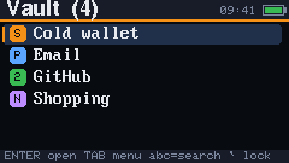
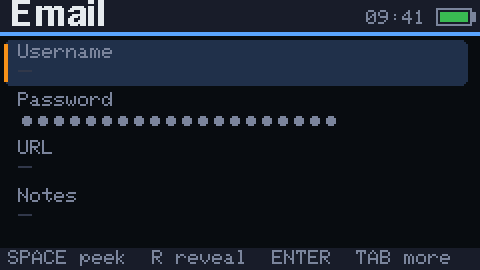
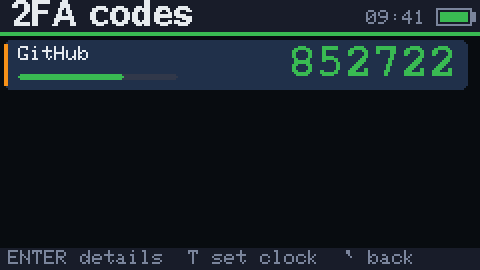
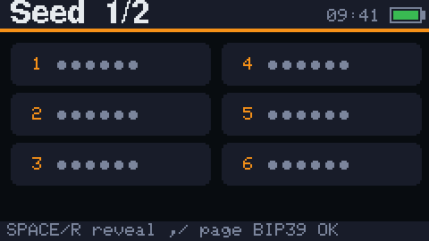
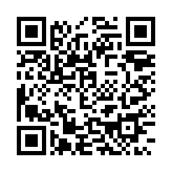
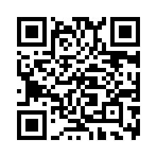

# CardVault

**An offline, encrypted secrets vault firmware for the M5Stack Cardputer ADV.**

Keep BIP39 seed phrases, passwords, 2FA (TOTP) secrets and private notes on your Cardputer,
encrypted with a passphrase only you know. No Wi-Fi. No Bluetooth. No cloud.

> ⚠️ **Early software (v0.x).** Always keep an independent backup (paper/metal) of any seed phrase.
> Read the [threat model](#security-model) before trusting CardVault with real funds.

<p align="center">
  
  
  
  
</p>
<p align="center"><sub>Real screens from the device, with made-up data.</sub></p>

## Features

| | |
|---|---|
| 🔐 **Encryption** | Argon2id key derivation (tuned to ~2 s per guess *on the device*; a computer guesses much faster, see the [security model](#security-model)) + XChaCha20-Poly1305 via [Monocypher](https://monocypher.org) |
| 🧠 **BIP39 helper** | Type seed words with autocomplete (4 letters are always enough), checksum validation, generate new 12/24-word seeds with the hardware RNG, view words page by page |
| 🔑 **Password generator** | Random characters or BIP39-word passphrases, unbiased sampling, entropy shown |
| ⏱️ **2FA codes** | RFC 6238 TOTP (6/8 digits, 30/60 s) with a live overview of all your codes |
| 💾 **SD backups** | Encrypted, verified backups to `/cardvault/*.cvb` on the microSD card, restorable on any Cardputer |
| 🛡️ **Brute-force guard** | On the device: escalating delays; **10 wrong passphrases in a row erase the vault** (it does not limit guessing on a copy of the data) |
| 🙈 **Privacy** | Secrets masked until you hold <kbd>Space</kbd> (revealed ones hide again after 20 s or on dimming), auto-lock with dimming, typed passphrases wiped when the lock screen idles, <kbd>G0</kbd> side button locks instantly |
| 📡 **Air-gapped** | The firmware never turns on Wi-Fi or Bluetooth (the radio drivers come with the Arduino framework and are linked in, but are never started) |

## Install

**Web flasher (easiest):** open the CardVault web flasher (GitHub Pages of this repo) in Chrome/Edge,
put the Cardputer in download mode (power off, hold <kbd>G0</kbd>, plug USB-C) and click *Install*.

**esptool:** download `cardvault-vX.Y.Z-cardputer-adv.bin` from
[Releases](https://github.com/Besermenji/cardvault/releases), check its SHA-256, then:

```sh
esptool.py --chip esp32s3 write_flash 0x0 cardvault-vX.Y.Z-cardputer-adv.bin
```

**M5Burner:** search for *CardVault* in M5Burner's Cardputer section.

**Next to other firmware (Launcher):** flash [Launcher](https://github.com/bmorcelli/Launcher), copy
`cardvault-vX.Y.Z-cardputer-adv.bin` to the SD card and install it from Launcher's SD menu. How
Launcher behaves is Launcher's business, not CardVault's: this is what CardVault is built for with
Launcher 2.9.1 (it reads the partition table in the image and creates a `vault` storage area), but it
has **not yet been verified on hardware** ([#28](https://github.com/Besermenji/cardvault/issues/28)).
CardVault only ever uses its own `vault` partition. Press <kbd>Enter</kbd>/<kbd>G0</kbd> while booting
to get back to Launcher and switch firmware.

On the first start after installing through Launcher, CardVault asks to **set up its storage area**. Say
**Y**: it only formats CardVault's own `vault` area and **doesn't touch Launcher or any other firmware**
installed on the device.

> ⚠️ Any other firmware you run can read CardVault's (encrypted) vault and reset its attempt counter,
> and could log your passphrase if it is the firmware you boot. Only install firmware you trust next to
> it, use a strong passphrase, and keep SD backups. Removing CardVault in Launcher may delete its
> storage area.

**From source:**

```sh
pio run -e cardputer -t upload
```

## Using it

| Key | Action |
|---|---|
| <kbd>fn</kbd> + <kbd>;</kbd> <kbd>.</kbd> <kbd>,</kbd> <kbd>/</kbd> | Up / Down / Left / Right (plain <kbd>;</kbd> <kbd>.</kbd> work in lists) |
| <kbd>Enter</kbd> | Open / confirm |
| <kbd>Tab</kbd> | Open the menu; in the editor, jump to *Save* (<kbd>Enter</kbd> saves) |
| <kbd>1</kbd>–<kbd>9</kbd> | Pick a menu item (destructive items are only selected; confirm with <kbd>Enter</kbd>) |
| <kbd>fn</kbd> + <kbd>`</kbd> (or <kbd>`</kbd> in lists) | Back / cancel |
| <kbd>opt</kbd> | Show/hide the passphrase while typing |
| hold <kbd>Space</kbd> / <kbd>Enter</kbd> / <kbd>R</kbd> | Peek at the selected secret / reveal that row / reveal all (hides again after 20 s) |
| <kbd>G0</kbd> (side button) | Lock immediately |

1. **First boot** — create a passphrase (twice). Use something long: five or more random words is ideal.
2. **Add secrets** — <kbd>Tab</kbd> → *New secret* → Seed phrase, Password, 2FA or Note.
3. **Seed phrases** — choose 12/18/24 words, type the first letters of each word and press
   <kbd>Enter</kbd>; CardVault checks the BIP39 checksum when you finish.
4. **2FA** — paste the *setup key* (base32) shown next to the QR code. Set the clock once per power-up
   (Settings → Set clock, UTC): the Cardputer ADV has no battery-backed clock.
5. **Backups** — Settings → *Backup to SD*. You choose a passphrase for the backup. **A backup file is
   guessable offline**: anyone who gets a copy can try passphrases on a computer with no attempt limit,
   at the same Argon2 cost as the vault. Give it its own long random passphrase; reusing the vault
   passphrase turns every copy of the file into a second way to attack it. The same goes for the
   safety copy that *Compact vault* writes (step 6): it is an ordinary backup under the **vault**
   passphrase, so delete it from the card on a computer once the compaction is done and the vault
   opens, or treat the card as being as sensitive as the device.
   Restore with Settings → *Restore from SD* (also available on the lock screen via <kbd>Tab</kbd>).
   Backups are numbered (`backup-0001.cvb`, ...) and never overwrite each other; the newest is listed first.
6. **Compact vault** — Settings → *Compact vault*. Flash keeps old encrypted copies of the vault after
   every save, including, after a passphrase change or restore, a copy that the **old** passphrase still
   opens. Compact first saves a verified safety copy to SD (it opens with your vault passphrase), then
   erases the vault storage and writes the current vault back. It needs an SD card, and it is offered
   automatically after a passphrase change or restore. Keep the power on while it runs; if the rewrite
   fails, the device will not lock until the vault is saved again. Afterwards the card holds
   `backup-000N.cvb` under the vault passphrase (see step 5).

## Security model

**How your data is protected**

- A random 256-bit data key encrypts the vault with **XChaCha20-Poly1305**. The data key is wrapped by a
  key derived from your passphrase with **Argon2id**. Memory is the largest free heap block minus a
  96 KiB reserve (128 KiB on a Cardputer ADV) and the passes are timed on your device for a ~2 s unlock
  (about 160 passes), then checked once against a real derive; both are stored in the file header and
  shown in Settings > About. Change passphrase re-tunes them. All header fields are authenticated; any
  modified byte is rejected. This is time-hard but only lightly memory-hard: the ~2 s is the cost *on
  this device*. One core of an Apple M1 running the same code computes about 120 guesses per second
  (measured 2026-10-27), about 240× faster, and GPUs or optimised code do better, so the passphrase
  has to carry the security.
- Plaintext is padded to 256-byte blocks so the file size leaks little about its contents.
- Decrypted data lives only in RAM while unlocked. On lock it is wiped (`crypto_wipe`) on a best-effort
  basis: the vault's own containers and string buffers use wiping allocators, but the Cardputer
  keyboard library's key buffer, the screen frame buffer (until the next redraw) and short copies of
  small strings made by library or UI code are not covered. A power cycle clears all of RAM.
- The failure counter is written to flash **before** each passphrase check, so pulling the battery
  doesn't reset it. After 10 consecutive failures the vault partition is erased. The wipe covers that
  partition only: SD backups and the settings (auto-lock, brightness) are left alone.
- Randomness comes from the ESP32-S3 hardware RNG with its ADC entropy source enabled, mixed with
  keystroke timing through a ratcheting BLAKE2b pool.

**What it does NOT protect against**

- **Offline guessing of SD backups.** A backup is only protected by its passphrase (see *Backups*
  above); the attempt limit does not apply to a file you can copy.
- **Flash dumps.** Without ESP32 secure boot + flash encryption (irreversible eFuse changes, not enabled
  by default), an attacker holding your device can read the encrypted vault off the flash chip and guess
  passphrases on a computer, bypassing the 10-attempt limit. Only a **strong passphrase** stops that.
  Until you run *Compact vault*, such a dump can also contain older versions of the vault, including
  ones protected by a passphrase you have since changed.
- **Someone else wiping your vault.** The 10-failure wipe works for anyone holding the device, so a
  stranger (or a child) can destroy the vault by guessing. That is why SD backups matter.
- **Rollback.** Nothing detects an old but valid vault or backup being put back, whether by someone
  writing the flash or by restoring an older backup yourself: you would get the old contents (and the
  old passphrase) back without a warning.
- A device that was tampered with (malicious firmware) *before* you type your passphrase.
- Shoulder surfing and cameras while secrets are revealed.
- Loss of the device without a backup.

See [SECURITY.md](SECURITY.md) for reporting vulnerabilities.

### Vault file format (v1)

```
header (104 B): "CVLT" | ver | kdf=2 | rsvd | mem_kib u32 | passes u32 | salt[16]
                wrap_nonce[24] | wrapped_dek[32] | wrap_mac[16]
body:           nonce[24] | mac[16] | XChaCha20-Poly1305(dek, u32 len | payload | pad)
```

The payload is a compact TLV list of entries (`src/vault/serializer.h`).

## Development

```sh
pio test -e native        # host unit tests: crypto vectors, BIP39, TOTP, vault format, guard
pio run -e cardputer      # firmware
tools/merge_bin.sh 0.1.0  # single image in release/
```

**Screenshots** (dummy data only!): flash `pio run -e cardputer-e2e -t upload` (with no SD card in), then run
`python3 tools/screenshots.py /dev/cu.usbmodem* --yes` (needs `pyserial`). It erases the e2e test vault, adds made-up
entries, drives the real UI to each main screen and writes the PNGs in `docs/screenshots/` (including
`cover.png` for M5Burner). For a one-off capture of any screen, flash `pio run -e cardputer-debug -t upload`, run
`python3 tools/screenshot.py /dev/cu.usbmodem*` and press <kbd>ctrl</kbd>+<kbd>S</kbd> on the device.
Neither the e2e nor the debug build is a release build; the hotkey exists only in the debug build, which runs on the test partition table (its vault
partition has a different label) with its own settings, so it cannot open a real vault and always starts with an
empty demo vault. CI checks that release images don't contain it.

Layout: `src/crypto`, `src/vault`, `src/features`, `src/security` are Arduino-free and unit tested;
`src/platform` talks to the hardware; `src/ui` holds the screens, styled as described in [DESIGN.md](DESIGN.md). See [CONTRIBUTING.md](CONTRIBUTING.md).

## Support

CardVault is free and MIT licensed. If it keeps your secrets safe, a donation pays for hardware and
development time.

| Bitcoin | Ethereum |
|:---:|:---:|
|  |  |
| `bc1qwa2d9rg06dz97rdcjg00cy3j9myevawq9075fy` | `0xa263474B98a69478aaeb7ac5562f1647D3c24712` |

These are the only donation addresses. If you see different ones somewhere else, check them against
this repository ([`docs/support/addresses.env`](docs/support/addresses.env); CI checks every copy).

## License

[MIT](LICENSE). Monocypher is vendored under its own BSD-2-Clause / CC0 license.
