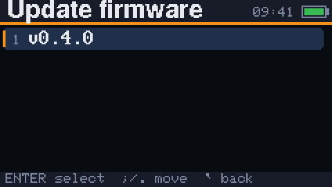
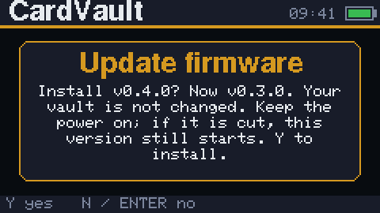
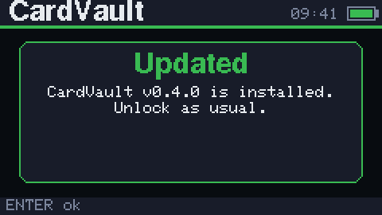

# Updating CardVault

**Make an SD backup first** (Settings > *Backup to SD*), as with any firmware change. An update
doesn't change your vault. How you update over USB matters, though: see the warning below.

| You installed with | Update with |
|---|---|
| The web flasher, esptool or M5Burner | **The SD card** (from v0.4.0 on), the web flasher, or esptool with the four part files |
| Launcher | Launcher. SD updates are switched off under Launcher. |
| From source | `pio run -e cardputer -t upload`, or the SD card |

## Warning: don't write the single `.bin` over a vault

`cardvault-vX.Y.Z-cardputer-adv.bin` is the whole firmware in one file, written at address `0x0`. It is
meant for a **first install**. It also overwrites the small area where CardVault counts wrong
passphrases. CardVault can't know how many guesses were used before, so it assumes the worst:

- you get **one** passphrase attempt,
- after a **5-minute wait**,
- and **if it is wrong, the vault is erased.**

Your vault itself is not touched, and the right passphrase opens it as before. The counter then starts
from zero again. This is on purpose: otherwise anyone could reinstall the firmware to get more guesses.

This applies to **M5Burner**, which can only write the single file, and to esptool or any other tool
writing that file at `0x0`. If you have already done it: take your time on the unlock screen, type the
passphrase, press <kbd>opt</kbd> to show it, and check it before you press <kbd>Enter</kbd>. The
screen says *1 attempt left before wipe*. If you aren't sure of your passphrase, don't press
<kbd>Enter</kbd> yet: powering off before <kbd>Enter</kbd> doesn't use up the attempt. Once you press
<kbd>Enter</kbd>, it counts, even if the power goes off.

The web flasher (with **Erase device unticked**) and the esptool command below leave the counter alone.

## Installed through Launcher

Update CardVault from Launcher, the way you installed it. CardVault's own *Update firmware* is switched
off there. Make an SD backup first.

If Launcher says it needs space and offers choices, pick **"Use" with CardVault's partition** (this
replaces the old CardVault and keeps the vault) or **Cancel**. **Never pick an option starting with
"Remove"**: Launcher can then delete CardVault's storage area, including the vault, whatever the
option's name says about the data it removes. (Read from Launcher's source, 2.9.1 to 3.0.0; not yet
tried on a device, see [#28](https://github.com/Besermenji/cardvault/issues/28).)

## Over USB

**Web flasher:** install as the first time, and **leave "Erase device" unticked**. Erasing the device
erases the vault.

**esptool:** download the four part files from the
[release](https://github.com/Besermenji/cardvault/releases/latest), check them against the `.sha256`
file, then:

```sh
esptool.py --chip esp32s3 write_flash \
  0x0     cardvault-vX.Y.Z-cardputer-adv-bootloader.bin \
  0x8000  cardvault-vX.Y.Z-cardputer-adv-partitions.bin \
  0xe000  cardvault-vX.Y.Z-cardputer-adv-otadata.bin \
  0x10000 cardvault-vX.Y.Z-cardputer-adv-app-only.bin
```

## Coming from v0.3.0 or older: one USB update first

Updating from the SD card needs a second firmware slot on the device. Versions up to v0.3.0 don't
have one. Update **once** over USB, with the web flasher or the esptool command above (not M5Burner,
see the warning). After that, every later version can come from the SD card.

Your vault is kept: it sits in the same place in flash, and none of these files reach it.

If you try an SD update before this, the device says *Full install needed*.

## Update from the SD card

You need a microSD card formatted as FAT32 (the one you use for backups works).

1. Open the [latest release](https://github.com/Besermenji/cardvault/releases/latest) and download
   `cardvault-vX.Y.Z-cardputer-adv.cvu`. Take it from that page only. CardVault refuses any `.cvu`
   file that isn't signed with the CardVault release key, so a file from somewhere else won't install.
2. Optional: check its SHA-256 against the `.sha256` file next to it on the release page.
3. Copy the `.cvu` file into the `cardvault` folder on the card, the folder where your backups are.
   Create the folder if it isn't there.
4. Put the card in the Cardputer, unlock CardVault and open Settings > **Update firmware**.
5. Pick the version. The list shows every `.cvu` on the card. *installed* marks the version you run
   now, *older* marks an older one, and *not valid* marks a file that can't be installed (pick it to
   see why).

   
6. Read the question and press <kbd>Y</kbd>. A progress bar shows the install. It takes a few seconds.
   Keep the power on.

   
7. CardVault restarts and says *Updated: CardVault vX.Y.Z is installed*. Press <kbd>Enter</kbd> and
   unlock as usual.

   

   The version numbers in these pictures are examples.

Settings > *About* shows the version and the slot it runs from (`app0` or `app1`). The slot changes
with each SD update; that is normal.

You can delete the `.cvu` file from the card afterwards. It holds no secrets.

### If the power goes off

The new version is written next to the one you run. The device switches over only once the whole
file has been written and checked. If the power goes off during the install, the old version starts
as before and you can try again.

If the new version doesn't start properly, the device goes back to the old one by itself. It then
says *Update rolled back*. Your vault is not changed. Please report it in an
[issue](https://github.com/Besermenji/cardvault/issues).

### Older versions

The SD card only installs the same or a newer version. To go back to an older one, install it over
USB (make a backup first: an older version may not read a vault written by a newer one). The web
flasher only offers the latest release; for an older one use esptool with that release's files.
Releases up to v0.3.0 have only the single `.bin`, so the warning above applies.

## Messages and what to do

| Message | Why | What to do |
|---|---|---|
| No SD card | No card, or it can't be read | Insert a FAT32 card and try again. |
| No update file | No `.cvu` in `/cardvault` | Copy the `.cvu` from the release into the `cardvault` folder. |
| Not available | CardVault runs under Launcher or with another partition table | Update CardVault from Launcher. |
| Full install needed | The device still has the partition table of v0.3.0 or older | Update once over USB: web flasher or the esptool command (see above). |
| Not an official CardVault file | Not signed with the CardVault release key | Download the file again from the GitHub release page only. |
| This update is for another device | Signed, but for different hardware | Download the `cardputer-adv` file. |
| Older version | The file is older than the version you run | Use the web flasher to go back, or pick a newer file. |
| The file is incomplete / damaged | Copying stopped, or the file changed | Copy it to the card again (check its SHA-256). |
| The card could not be read | The card failed or was pulled during the install | Check the card and try again. Nothing was changed. |
| Writing the update failed | The flash write failed | Nothing was changed. Try again; if it keeps failing, report it. |
| Your vault is only in memory | An earlier *Compact vault* could not write the vault back | Fix that first (Settings > *Compact vault*), then update. |

## Why the file is signed

Without a check, anyone holding your unlocked Cardputer could install firmware from a card, and a
lookalike firmware could record your passphrase. So CardVault installs a `.cvu` only if it is signed with the CardVault
release key, and only while the vault is unlocked. The signing key exists only in the release
workflow of this repository and in an offline backup (see [SECURITY.md](../SECURITY.md)).

On a device with secure boot and flash encryption (see [HARDENING.md](HARDENING.md)), USB flashing
is closed. There, the SD card would be the only way to update. That setup isn't supported yet
([#23](https://github.com/Besermenji/cardvault/issues/23)).
